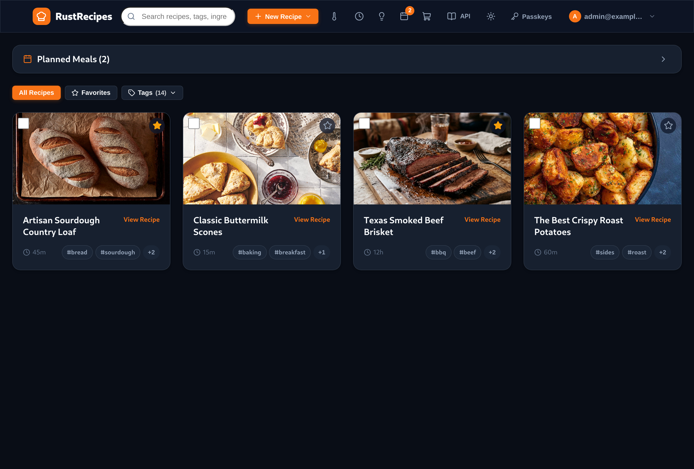
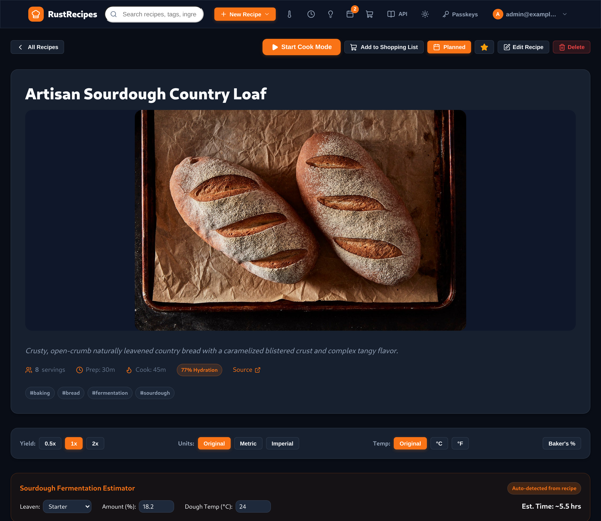

# Rust Recipe Manager

A fast, self-hosted recipe manager built with Rust, Axum, and React. Designed for home cooks, sourdough bakers, and BBQ enthusiasts.


## 📸 Preview

<table style="width: 100%; border-collapse: collapse;">
  <tr>
    <td style="width: 50%; vertical-align: top;">
      <strong>Recipe Cards List</strong><br/>
      
    </td>
    <td style="width: 50%; vertical-align: top;">
      <strong>Recipe Overview</strong><br/>
      
    </td>
  </tr>
</table>

## ✨ Features

- **Default Modern React SPA & PWA** — High-performance single page application served at root `/` and `/app/`, installable as a Progressive Web App (PWA) with offline shell caching, instant search, collapsible tag filters, dark/light mode, and full browser back/forward history navigation.
- **Mobile-Responsive Design** — Tailored mobile experience with flexible multi-row headers, touch-friendly tabbed recipe views (Ingredients, Directions, Graphs, Fermentation, Notes), responsive forms, and safe-area insets.
- **Wake Lock Control** — Dedicated screen wake lock button (`#wakelock-btn`) powered by the Screen Wake Lock API to prevent devices from sleeping while cooking.
- **Cooking Timer** — Quick-access floating timer with smart suggestions extracted from recipe cook times, sound/vibration alerts, and browser notifications.
- **Cooking Temperatures & USDA Log 7** — Built-in meat temp reference and an interactive hold-time calculator for safe poultry lethality at lower temps.
- **Multi-Tag Filtering** — Apply multiple tags with AND logic; collapsible tag panel dynamically updates to show active and matching tags.
- **Favorites** — Mark recipes as favorites from cards or detail pages; filter by favorites on the home screen.
- **Ingredient Scaling & Unit Conversion** — Scale yields (0.5x–2x) and convert between Original, Metric, and Imperial inline with highlighted conversion text.
- **Baker's Percentage Mode** — Auto-activates for `bread`/`dough` tagged recipes, showing hydration and ratios relative to flour weight.
- **Combustion Inc. Integration** — Upload thermometer CSV exports to visualize core, surface, and ambient temps with interactive charts.
- **Fermentation Calculator** — Estimates proofing times based on yeast/starter amounts and kitchen temperature.
- **Smart Import** — Scrape recipes from URLs (LD+JSON or Gemini AI fallback), import Paprika archives, or snap a photo of a cookbook page with AI Vision.
- **YouTube Import** — Paste a YouTube URL to generate a recipe from the transcript via Gemini AI, with an embedded player for follow-along.
- **Shopping Lists** — Select multiple recipes, scale portions, and generate a combined ingredient list. Lists are persisted server-side with check-off state and can be cleared.
- **Multi-User & Access Control** — Self-service registration, bcrypt passwords, WebAuthn Passkeys, OpenID Connect (OIDC / Pocket ID), Google OAuth 2.0, per-user recipe ownership, and public/private visibility toggles.
- **Admin User Management** — Dedicated admin user management interface (`/admin/users`) for administrators to manage users and roles.
- **User Data Export** — One-click backup of all user data (`/export` or `/api/v1/user/export`), downloading a comprehensive JSON archive containing owned recipes, ingredients, instructions, notes, meal plans, shopping list, and favorites.
- **Structured Logging & Observability** — Built-in tracing powered by `tracing_subscriber` and `tower_http::TraceLayer`, configurable via `RUST_LOG` (defaults to `recipemanager=info,tower_http=info`).
- **REST API** — Full CRUD API (`/api/v1`) with token auth for programmatic access. Built-in interactive API guide at `/api` and OpenAPI 3.0 spec at `/api/docs`.

---

## 🔌 API

**Base URL**: `/api/v1` — [Interactive Swagger UI at `/api/docs`](/api/docs) • [OpenAPI 3.0 Specification at `/api/v1/openapi.json`](/api/v1/openapi.json) • [Interactive Playground at `/api`](/api)

| Endpoint | Method | Description |
| :--- | :--- | :--- |
| `/openapi.json` | `GET` | OpenAPI 3.0.3 specification JSON. |
| `/auth/me` | `GET` | Current user identity and admin status. |
| `/auth/login` | `POST` | Authenticate with email/password and establish session. |
| `/auth/logout` | `POST` | Terminate session and clear cookie. |
| `/user/export` | `GET` | Download full user data export (recipes, notes, meal plans, shopping list, favorites) as JSON. |
| `/recipes` | `GET` | List recipes with search, tag filtering, and pagination. |
| `/recipes` | `POST` | Create a recipe (normalized into relational SQLite tables). |
| `/recipes/{id}` | `GET` | Get recipe with server-side conversion (`scale`, `unit`, `temp`, `bakers`). |
| `/recipes/{id}` | `PUT` | Update a recipe. |
| `/recipes/{id}` | `DELETE` | Delete a recipe. |
| `/recipes/{id}/notes` | `GET`, `POST` | Read or save per-user private recipe notes. |
| `/shopping-list` | `GET` | Retrieve saved shopping list items and checked state. |
| `/shopping-list` | `POST` | Generate consolidated list from recipe IDs and portions. |
| `/shopping-list` | `PUT` | Save/update shopping list items and checked state. |
| `/shopping-list` | `DELETE` | Clear the saved shopping list. |
| `/meal-plan` | `GET` | Weekly meal planner schedule. |
| `/meal-plan` | `POST` | Schedule recipe or custom meal entry. |
| `/meal-plan/{id}` | `DELETE` | Remove meal plan item. |
| `/meal-plan/toggle` | `POST` | Quick toggle recipe on meal planner. |
| `/temps` | `GET` | Internal meat doneness temperature reference. |
| `/spices` | `GET` | Common kitchen pantry spices list. |
| `/log7` | `GET` | USDA Log 7 poultry pasteurization hold-time calculator. |
| `/ferment` | `GET` | Sourdough starter and yeast dough fermentation estimator. |
| `/import` | `POST` | Scrape recipe from URL or photo via AI. |

Bearer token authentication (`Authorization: Bearer <token>`) or active browser session cookies are supported across all endpoints.

---

## 🔐 Generating an Admin Password Hash

```bash
# With Rust installed locally
cargo run --bin hash_password "my_secure_password"

# Or via Docker
docker run --rm dnewsholme/recipemanager:latest ./hash_password "my_secure_password"
```

Copy the output (e.g., `$2y$12$...`) and use it as `ADMIN_PASSWORD_HASH`.

---

## 🚀 Running Locally

**Environment Variables**:

| Variable | Required | Description |
| :--- | :--- | :--- |
| `ADMIN_EMAIL` | **Yes*** | Email address of the default admin account (*optional when OIDC is configured). |
| `ADMIN_PASSWORD_HASH` | **Yes*** | Bcrypt hash for admin login (*optional when OIDC is configured; defaults to password `"admin"` if `ADMIN_EMAIL` is set without a hash). |
| `API_TOKEN` | Yes | Token for API write access. |
| `SESSION_SECRET` | Recommended | Signs session cookies. Sessions reset on restart if omitted. |
| `GEMINI_API_KEY` | No | Enables AI photo/video/URL import via [Google AI Studio](https://aistudio.google.com/app/apikey). |
| `OIDC_ISSUER_URL` | No | OIDC base issuer URL (e.g., `https://id.example.com`). Fetches `/.well-known/openid-configuration` auto-discovery. |
| `OIDC_CLIENT_ID` | No | OIDC Client ID. |
| `OIDC_CLIENT_SECRET` | No | OIDC Client Secret. |
| `OIDC_REDIRECT_URI` | No | OIDC callback URL (defaults to `<app_base>/login/oidc/callback`). Back-channel logout webhook is available at `<app_base>/logout/oidc/backchannel` (and `/oidc/backchannel-logout`). |
| `OIDC_PROVIDER_NAME` | No | Display name on the login button (defaults to "OIDC"; e.g. "Pocket ID"). |
| `OIDC_ADMIN_GROUP` | No | OIDC group name whose members are granted administrator privileges in the app (also accepts `OIDC_ADMINS_GROUP`; defaults to `admins`). |
| `OIDC_AUTH_URL` | No | Manual authorization endpoint override. |
| `OIDC_TOKEN_URL` | No | Manual token endpoint override. |
| `OIDC_USERINFO_URL` | No | Manual userinfo endpoint override. |
| `OIDC_SCOPES` | No | Custom OIDC scopes requested (defaults to `openid email profile groups`). |
| `GOOGLE_CLIENT_ID` | No | Google OAuth 2.0 Client ID. |
| `GOOGLE_CLIENT_SECRET` | No | Google OAuth 2.0 Client Secret. |
| `GOOGLE_REDIRECT_URI` | No | OAuth callback URL (defaults to `<app_base>/login/google/callback`). |
| `APP_BASE` | No | Subpath prefix for reverse proxy setups (e.g., `/recipes`). |
| `RUST_LOG` | No | Logging filter string (defaults to `recipemanager=info,tower_http=info`). |

```bash
git clone https://github.com/dnewsholme/recipemanager.git
cd recipemanager

# Optional: Build the modern SPA frontend (prebuilt assets are also bundled)
cd frontend && npm install && npm run build && cd ..

# Launch server
export ADMIN_EMAIL='admin@example.com'
export ADMIN_PASSWORD_HASH='<your_generated_hash>'
export API_TOKEN='your_api_token_here'
export SESSION_SECRET='your_random_secret_string'
cargo run
```

Available at `http://localhost:3000` (Modern React SPA default UI) and `http://localhost:3000/app/`.

---

## 🐳 Docker

```bash
docker run -d \
  --name recipemanager \
  -p 3000:3000 \
  -e ADMIN_PASSWORD_HASH='<your_generated_hash>' \
  -e API_TOKEN='your_api_token_here' \
  -e SESSION_SECRET='your_random_secret_string' \
  -v /path/to/your/data:/app/data \
  dnewsholme/recipemanager:latest
```

### Data Directory (`/app/data`)
- `recipes.db` — SQLite database (users, recipes, meal plans).
- `uploads/` — Cover images and Combustion CSV files.
- `recipes/` — (Legacy) Place old `.md` files here; they'll be auto-migrated on startup.

---